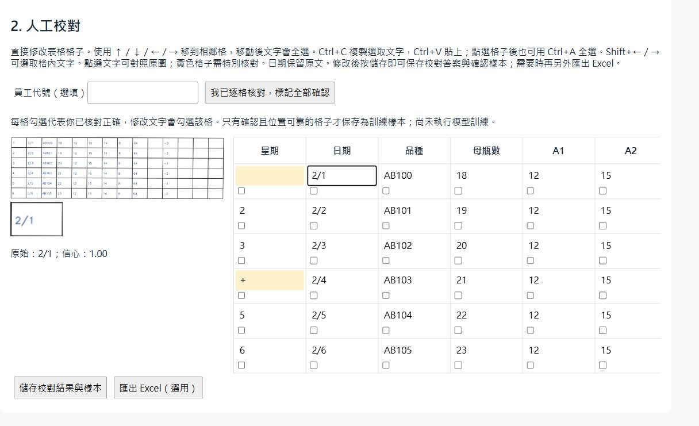

# Handwritten Form OCR and Review

A local Python tool that turns photographed forms into an editable table and an Excel workbook. OpenCV locates the grid, pretrained PaddleOCR models suggest cell contents, and a Flask interface lets the user inspect and correct each reading.

**The central engineering problem:** handwritten recognition is imperfect. This project combines image processing with explicit human review so that recognition errors can be checked before export.



*The screenshots use a synthetic printed form. Recognition errors remain visible; this is an interface demonstration, not a handwriting accuracy benchmark.*

## What the implementation covers

- Perspective correction and detection of a fixed 14-column table.
- Text-box assignment to cells, with warnings for ambiguous or crossing text.
- Field-specific recognition and checks for dates, codes and numeric values.
- An editable review table with source-crop inspection and keyboard navigation.
- Separate saving of reviewed values, confirmed crop labels and Excel exports.
- Recognizer comparisons and a limited classifier fine-tuning experiment.

The project integrates pretrained models with application logic. It does not implement YOLO, introduce a new OCR architecture, or automatically retrain when corrections are saved.

## Quick start

Use **64-bit Python 3.12**. Run these commands from the repository directory:

```powershell
python -m venv .venv
.\.venv\Scripts\python.exe -m pip install -r requirements.txt
.\.venv\Scripts\python.exe python/app.py
```

Open [http://127.0.0.1:5000/](http://127.0.0.1:5000/). The interface is currently in Traditional Chinese; an English [demo walkthrough](docs/DEMO.md) explains the controls.

The first OCR request may download pretrained models. Recognition runs locally on CPU and can take several minutes. The application binds to localhost and is intended for local use.

## Try the included synthetic example

1. Upload [examples/synthetic-form.png](examples/synthetic-form.png).
2. Check the four data-area corners, including the first row beginning with `1 / 2/1 / AB100`, and generate a grid preview. Automatic suggestions may start one row too low; move the upper handles to include all six rows.
3. Keep the first data row set to 1 and start recognition.
4. Compare cell readings against the image, correct errors and confirm reviewed cells.
5. Save the review, then export Excel if needed.

[examples/expected.json](examples/expected.json) contains the intended values for manual comparison. It is ground truth for this printed example, not recorded OCR output. The example can be regenerated with `python scripts/generate_demo.py` after installing the application dependencies.

## Design decisions and limitations

The supported layout has 14 fixed columns. Grid geometry and text-box overlap help locate entries, while uncertain readings remain visible for review. Confirmed samples with estimated or crossing positions are excluded from training-label collection.

The tool is a local prototype. It does not establish reliable unattended transcription, performance on new writers, or generalisation to unseen forms. Blurred images, missing rules, merged cells and crossed-out text still need manual attention. The printed demo does not test handwriting recognition.

## Experiments

Small calibration experiments used three previously used photographs; the private photographs and labels are not distributed.

- PP-OCRv4 English reached 52/121 nonblank exact matches with border trimming and padding, and 59/121 with tighter cropping. The latter introduced more blank false positives.
- The tested TrOCR handwritten variants performed worse on these crops.
- Training only the final CTC classifier left exact matches unchanged at 55/121 on a separate preprocessing baseline.

These are limited local experiments, not independent final-test results or end-to-end workflow accuracy. See the [technical notes](docs/TECHNICAL.md#recognition-experiments) for denominators, blank errors, splits and reproduction commands.

## Project map

| Location | Purpose |
| --- | --- |
| `python/app.py` | Local Flask endpoints and review persistence |
| `python/templates/index.html` | Corner selection and review interface |
| `python/preprocessing.py`, `python/grid_detection.py` | Image correction and grid geometry |
| `python/cell_pipeline.py`, `python/text_review.py` | Recognition, validation and workbook output |
| `python/review_data.py` | Cell assignment and confirmed crop labels |
| `python/compare_recognizers.py`, `python/finetune_recognizer.py` | Optional recognition experiments |
| `tests/` | Geometry, review, export and evaluation checks |
| `examples/` | Synthetic input and intended values |

## Checks

The tests use synthetic fixtures and mocked recognizers; they do not download OCR weights or measure handwriting accuracy.

```powershell
python -m pip install -r requirements-test.txt
python -m unittest discover -s tests -v
```

Full application setup and optional experiment environments are documented in the [technical notes](docs/TECHNICAL.md).

## Data and third-party components

This distribution contains source code, synthetic demonstration data and interface screenshots. Real photographs, employee records, annotations, generated runs and model weights are excluded. Reviews stay under the ignored `runs/` directory.

OpenCV, PaddleOCR, Flask, openpyxl and optional model backends are third-party components; their licenses and model terms remain applicable. See [third-party notes](THIRD_PARTY_NOTICES.md).
