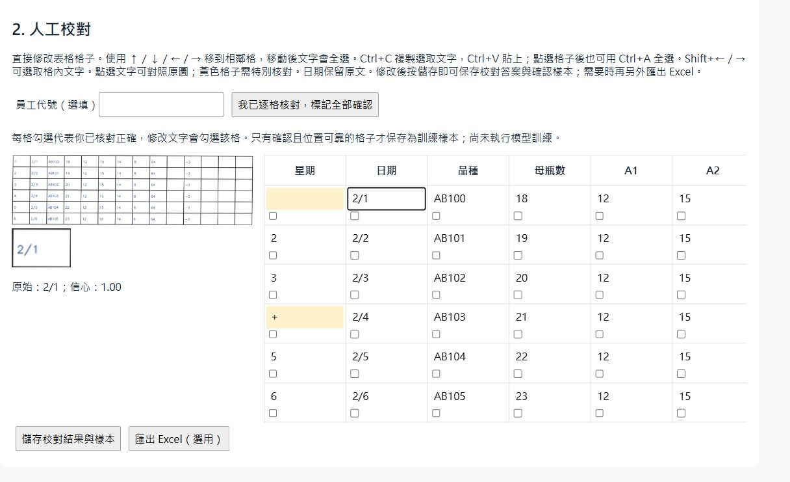
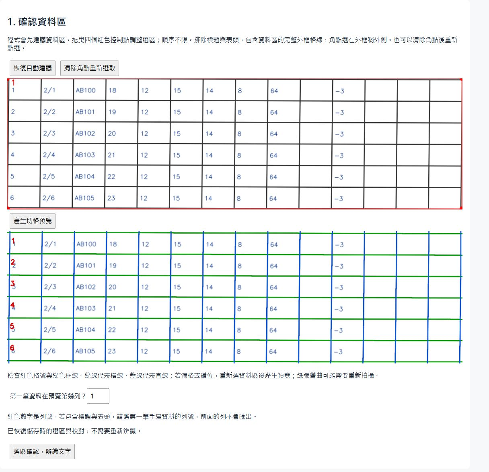

# Handwritten Form OCR and Review

A local tool for turning photographs of handwritten forms into an editable table and an Excel workbook. It uses **OpenCV** to correct perspective and find the grid, **PaddleOCR** to suggest cell contents, and **Flask** for review before export with **openpyxl**.

The web application supports one fixed **14-column form**. Recognition uses pretrained OCR models, and handwritten entries still need manual review. This project does not use YOLO.

## Interface preview

Inspect a source crop beside the editable table, move between cells with the keyboard, and save corrections separately from Excel export. The table scrolls horizontally to reveal all 14 columns.



<details>
<summary>View corner selection and the detected grid</summary>



</details>

The screenshots use a **synthetic printed form** to show the grid detection, OCR output and review interface. Recognition errors are left visible. The example contains no private report data or employee identifiers and is not a handwriting-accuracy test.

## Workflow

```text
Photograph
    → suggested data-area corners, adjusted by the user
    → perspective correction and grid preview
    → text detection and recognition
    → editable table and source-crop inspection
    → save reviewed answers and confirmed crops
    → optional Excel export
```

1. **Locate the table.** OpenCV suggests four corners around the data area. The user checks or adjusts them before perspective correction.
2. **Locate cells.** Adaptive thresholding and horizontal/vertical morphology extract grid fragments. Compatible fragments are fitted into tracks; their intersections define cell boundaries. The preview must be checked before recognition.
3. **Recognise text.** The default flow detects complete text boxes with PaddleOCR and assigns them by overlap. Located numeric/code fields can be reread with the English recognizer; Chinese notes are preserved. Date fields also compare enlarged and mildly enhanced crops, highlighting disagreements without silently replacing the original reading.
4. **Review and save.** Edit values while inspecting their source crops. Confirmed, reliably located cells produce image/text labels for later experiments. Saving does not train a model.
5. **Export when needed.** Excel export is separate from saving. Dates and codes remain strings; the workbook includes OCR-versus-reviewed values and unplaced text when present.

Cross-cell text is retained in one suggested cell and flagged for review. Estimated and cross-cell positions are excluded from training-label collection. Field checks flag unusual dates, codes and numeric values without deleting Chinese exceptions or rewriting the user's answers.

## Run locally

Use **64-bit Python 3.12**. From the repository directory, create an environment using your installed Python executable:

```powershell
python -m venv .venv
.\.venv\Scripts\python.exe -m pip install -r requirements.txt
.\.venv\Scripts\python.exe python/app.py
```

If `python` is not on PATH, replace it with the full path to your Python installation. Open [http://127.0.0.1:5000/](http://127.0.0.1:5000/). The HTML is a Flask template: open the HTTP address, not `python/templates/index.html` directly.

To use another port:

```powershell
.\.venv\Scripts\python.exe python/app.py --port 5001
```

The first OCR request may download pretrained models. Recognition runs locally on CPU and can take several minutes. The development server handles one request at a time because the Paddle predictors are shared. Stop it with Ctrl+C.

### Review controls

- Upload a photograph, adjust the data-area corners and check the grid preview.
- Exclude any selected header rows before starting recognition.
- Click a field to inspect its crop. Arrow keys move up/down/left/right between fields; Ctrl+C and Ctrl+V copy/paste text in a field. Shift+arrows select text. Multi-cell spreadsheet paste is not implemented.
- Editing a value marks it confirmed. Otherwise, check it only after comparing it with the photograph. Use "confirm all" only after reviewing the entire table.
- Save corrections and samples without exporting Excel. A saved record can restore edits and confirmation states without rerunning OCR; unsaved edits are not restored.

## Structure

```text
python/
├── app.py                 # Local Flask endpoints and saved-review workflow
├── templates/index.html   # Corner selection, grid preview and editable table
├── preprocessing.py       # Image loading, cropping and enhancement
├── grid_detection.py      # Grid fragments, fitted tracks and intersections
├── cell_pipeline.py       # Form schema, cell geometry, checks and Excel output
├── text_review.py         # Text-box OCR and field-specific recognition
├── review_data.py         # Cell assignment and confirmed crop labels
├── main.py                # Alternative PPStructure command-line experiment
├── evaluate_excel.py      # Compare an OCR workbook with manual answers
├── compare_recognizers.py # Pretrained recognizer comparison on labelled crops
└── finetune_recognizer.py # Limited CPU classifier fine-tuning experiment
tests/                     # Geometry, review, export and evaluation checks
requirements.txt           # Main application dependencies
requirements-comparison.txt # Optional isolated PP-OCRv5 comparison environment
requirements-trocr.txt     # Optional isolated TrOCR comparison environment
```

Photographs, annotations, generated workbooks, labels, model weights and Python environments stay local and are ignored by Git. Historical exploratory scripts are not part of the supported application. No external PaddleOCR source checkout is required to run the web editor.

## Saved data and evaluation

Each upload is stored under `runs/web/<job>/`. Reviewed values and confirmation metadata are saved there. `samples/labels.jsonl` maps confirmed crop filenames to answers, source identifiers and an optional employee alias. Empty confirmed values are blank examples. Only manifest entries belong to the saved review; older crop files may remain.

A manually corrected Excel workbook can provide reference answers, provided its rows, columns, blanks and text formats match the OCR workbook. The evaluator compares an **unedited OCR export** against those answers:

```powershell
.\.venv\Scripts\python.exe python/evaluate_excel.py --make-template runs/manual.xlsx --rows 27
.\.venv\Scripts\python.exe python/evaluate_excel.py --manual runs/manual.xlsx --prediction runs/ocr.xlsx --output runs/evaluation.json
```

Choose the actual row count for your photograph. The tool rejects mismatched headers, row counts and Excel-converted dates. It reports nonblank exact matches, blank false positives and cell differences. Excel comparison alone does not pair answers with image crops for training; confirmed training labels currently come from the web editor.

## Recognition experiments

These are local calibration experiments on **three previously used photographs**, not independent final tests or measurements across new employees. Real crop data is not distributed with this repository.

| Pretrained recognizer | Crop preparation | Exact nonblank matches | Blank false positives |
|---|---|---:|---:|
| PP-OCRv4 English | Small border trim and white padding | 52/121 (43.0%) | 0/20 |
| PP-OCRv4 English | Tighter ink-component bounds | 59/121 (48.8%) | 5/20 |
| TrOCR base handwritten | Small border trim and white padding | 11/121 (9.1%) | 20/20 |
| TrOCR base handwritten | Tighter ink-component bounds | 9/121 (7.4%) | 20/20 |

All four runs used identical confirmed English/numeric cells and fixed blank examples; 16 Chinese-labelled cells were excluded. Tighter cropping improved some PaddleOCR readings but increased blank false positives. Neither tested TrOCR variant justified replacing the web recognizer. These crop-level scores do not measure the complete web workflow, table localisation or Chinese handwriting.

A separate leave-one-photograph-out experiment trained only PP-OCRv4's final CTC character classifier for 20 epochs, with the visual backbone and sequence encoder frozen. Exact matches remained **55/121 before and after**. It used the official training architecture's preprocessing, so its baseline is separate from the crop comparison above. It does not establish whether full-model fine-tuning would help. No experimental weights were installed in the web application.

### Reproduce a pretrained comparison

Use the same confirmed manifest and crop variant for both backends. For the English TrOCR checkpoint, select English/numeric labels. Create a separate environment to keep its dependencies out of the application environment:

```powershell
.\.venv\Scripts\python.exe -m venv .venv-trocr
.\.venv-trocr\Scripts\python.exe -m pip install torch==2.8.0 --index-url https://download.pytorch.org/whl/cpu
.\.venv-trocr\Scripts\python.exe -m pip install -r requirements-trocr.txt
.\.venv-trocr\Scripts\python.exe python/compare_recognizers.py --samples runs/web/your-job-id/samples --backend trocr --variant trimmed --output runs/comparison/trocr.json
.\.venv\Scripts\python.exe python/compare_recognizers.py --samples runs/web/your-job-id/samples --backend v4 --variant trimmed --output runs/comparison/paddle.json
```

The JSON reports preserve individual answers/predictions, character error rate, blank errors and inference time. TrOCR downloads public model weights and processes crops locally. The tested checkpoint revision was `eaacaf452b06415df8f10bb6fad3a4c11e609406`. Its [model documentation](https://huggingface.co/microsoft/trocr-base-handwritten) describes single-line OCR fine-tuned on IAM; it is not a Chinese handwriting recognizer.

### Limited fine-tuning

Download the matching `release/2.9` source and PP-OCRv4 English **training weights** from the [official PaddleOCR repository](https://github.com/PaddlePaddle/PaddleOCR/tree/release/2.9) and [model list](https://github.com/PaddlePaddle/PaddleOCR/blob/release/2.9/doc/doc_ch/models_list.md). Inference files cannot replace `.pdparams` training weights.

```powershell
.\.venv\Scripts\python.exe python/finetune_recognizer.py --source .models/training/PaddleOCR-release-2.9 --weights .models/training/en_PP-OCRv4_rec_train/best_accuracy.pdparams --output runs/training/my-experiment --epochs 20
```

The experiment snapshots confirmed crops, excludes unsupported dictionary characters, separates folds by original photograph and starts each fold from the same official weights. Held-out photographs are not used to choose checkpoints. Different photographs do not establish different writers. Source/weight checksums, splits, results and checkpoints stay in ignored local folders.

## Checks

```powershell
.\.venv\Scripts\python.exe -m unittest discover -s tests -v
.\.venv\Scripts\python.exe -m pip check
```

The tests cover image preprocessing, grid geometry, coordinate order, field/date handling, cross-cell assignment, confirmation eligibility, review saving, workbook values and evaluation metrics. They do not prove handwriting accuracy or complete browser interaction correctness.

## Alternative command-line experiment

`main.py` runs PaddleOCR 2.x PPStructure in single-table mode rather than the web editor's fixed-grid workflow. Supply your own local photograph:

```powershell
.\.venv\Scripts\python.exe python/main.py --input data/form.jpg --output runs/cli-example
.\.venv\Scripts\python.exe python/main.py --input data/form.jpg --output runs/preprocess-example --preprocess shadow --preprocess-only
```

Options include `--preprocess none|binary|shadow`, `--no-crop` and `--preprocess-only`. Use a new or empty output directory. Outputs include `cropped.png`, `ocr-input.png`, `result.json` and table workbooks when PPStructure returns a table. Enhancement can damage faint strokes; inspect the actual OCR input before drawing conclusions.

## Scope and remaining limitations

The prototype supports local demonstration and manual review, not unattended production transcription. It targets one form layout; severe curvature, missing lines, merged cells, blur and crossed-out text still need review. Field validity and model confidence do not prove an answer is correct. New-writer and unseen-form accuracy have not been established. Saving corrections collects labels but does not automatically teach the model.

Use photographs and reference answers you have permission to process. Real source data is excluded from this distribution. The application is a local Flask development server and has not been prepared for public hosting.
